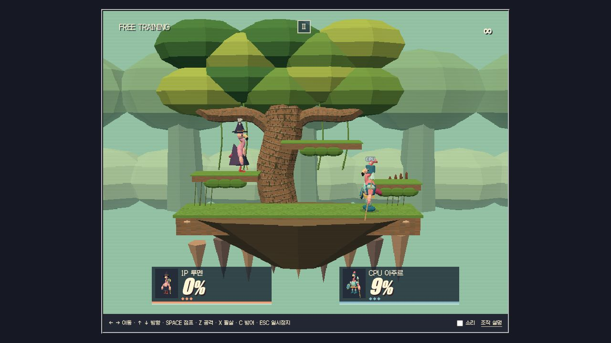

<div align="center">

# FLAMINGO RINGOUT 64

**네 명의 홍학. 세 개의 공중 무대. 마지막까지 남으면 승리.**

<a href="https://github.com/minwoo19930301/flamingo-ringout-64"></a>
<a href="docs/art-direction.md"></a>
<a href="docs/mechanics.md"></a>

</div>

[](docs/browser-qa.md)

Nintendo 64 시대의 플랫폼 대전 화면과 조작 문법을 플라밍고 캐릭터로 각색한 **독립 게임**이다. 포털이나 다른 미니게임 런타임에 의존하지 않는다. 원작 ROM·캐릭터·텍스처·음악은 사용하지 않았으며 모델과 무대는 편집 가능한 자체 코드로 만들었다.

## 실행

Node.js 22.12 이상:

```sh
npm ci
npm run dev
```

로컬 개발 주소: `http://127.0.0.1:4209/`. 포트가 사용 중이면 다른 포트로 넘어가지 않고 종료한다. Sites 설정이나 배포 스크립트는 없다.

```sh
npm test
npm run build
npm run preview
node scripts/simulate-matches.mjs
```

## 전투원 / 무대

| 전투원        | 스타일                             | 대표 기술        |
| ------------- | ---------------------------------- | ---------------- |
| **코랄**      | 빠른 킥복서 · 머리띠와 장갑        | 코럴 드릴        |
| **마담 수프** | 무거운 주방장 · 큰 체형과 프라이팬 | 프라이팬 홈런    |
| **아주르**    | 긴 사거리 기사 · 창과 방패         | 산호 창 돌진     |
| **루멘**      | 공중형 마녀 · 망토와 달 지팡이     | 달빛 깃털 투사체 |

**조개왕관 성채**의 벽돌 아치와 산호 지붕, **비밀 부들숲**의 비대칭 가지, **달빛 우편선**의 프로펠러 갑판에서 대전한다. 캐릭터 4명과 상대 CPU, 무대를 따로 선택한다.

## 조작

| 입력         | 동작                           |
| ------------ | ------------------------------ |
| ← → / A D    | 이동                           |
| Space        | 점프, 공중에서 한 번 더        |
| Z / 방향 + Z | 일반 / 위·아래·옆 공격         |
| X / ↑ + X    | 필살기 / 공중 복귀             |
| C            | 지상 방어                      |
| ↓            | 보조 발판 내려가기 / 빠른 낙하 |
| Escape / P   | 일시정지, 계속하기             |

3스톡·150초. 피해율을 쌓으면 더 멀리 날아간다. 기본 난이도는 **입문**이며 선택 화면에서 보통으로 바꿀 수 있다. 처음에는 **자유 연습**에서 이중 점프와 ↑ + X 복귀를 익힐 수 있다. 소리는 기본 꺼짐이며 하단 체크박스로 켠다. 작은 화면에서는 터치 조작 버튼이 표시된다.

## 문서

<table><tr>
<td><a href="docs/art-direction.md"><strong>ART DIRECTION</strong></a><br>공식 화면에서 무엇을 관찰했고, 어떤 새 모델로 각색했는지</td>
<td><a href="docs/mechanics.md"><strong>GAME RULES</strong></a><br>충돌·복귀·CPU·입력 수명과 구현 범위</td>
<td><a href="docs/assets.md"><strong>ASSET LEDGER</strong></a><br>원본 메시, 텍스처, 서체와 라이선스</td>
</tr></table>

자동 테스트는 물리·상태 전이·캐릭터 리그와 CPU 대전 시뮬레이션을 검증한다. 별도의 [실제 브라우저 검수](docs/browser-qa.md)에서 네 캐릭터·세 무대 미리보기, 짧은 점프/필살 입력, 투사체 적중, 일시정지와 재시작을 확인했다. 위 이미지는 실제 WebGL 플레이 캡처다. 모바일 실기기·게임패드·사람의 전체 대전 완주는 검증하지 않았다.

범위: 1P 대 CPU, 4캐릭터, 3무대, 연습/대전/결과/재경기. 온라인·4인전·게임패드·아이템은 포함하지 않는다.

---

[다른 독립 플라밍고 게임 보기](https://github.com/minwoo19930301/flamingo-arcade-2) · [Super Mario 2.5D](https://github.com/minwoo19930301/mario-2-5d)
